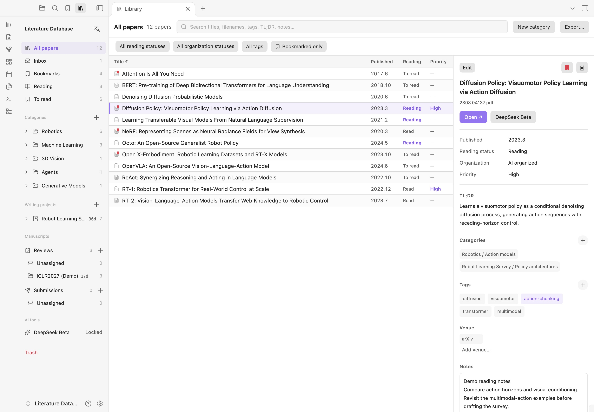
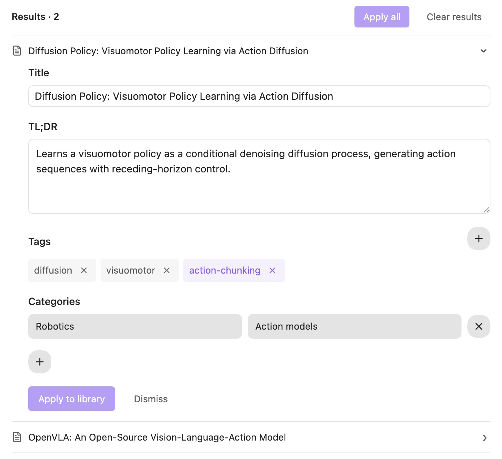
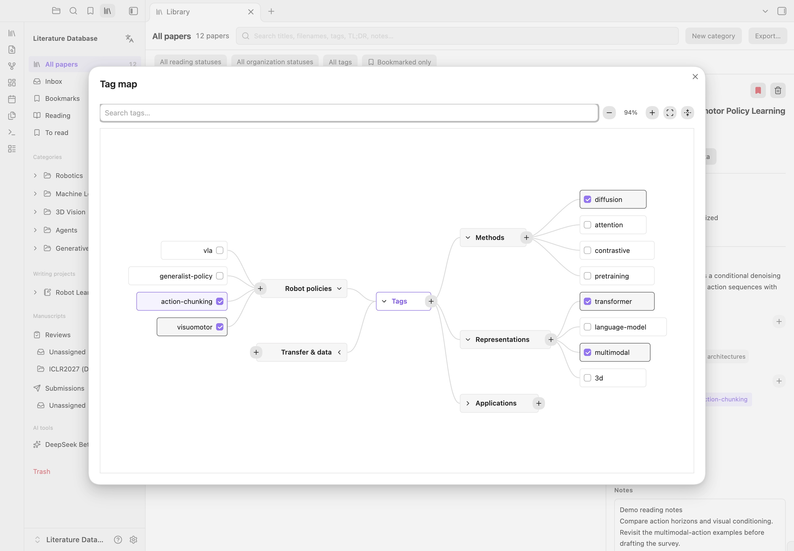

# Literature Database

A compact, Zotero-style literature manager for Obsidian, by **shengzhegan**. Organize papers, read, take notes and prepare references in one workspace. Your library stays in Markdown, alongside the original PDFs.

[Install in Obsidian](https://community.obsidian.md/plugins/paper-reservoir-dashboard) · [中文指南](docs/usage.zh-CN.md) · [Releases](https://github.com/Lgx521/Literature_Database_Obsidian/releases)

## AI organization

Plan Inbox categories and tags together before organizing individual papers. DeepSeek Beta is included and enabled by default. Add your API key, choose a model from DeepSeek’s live model list, and organize your Inbox or papers with missing information.

- Get paper titles, TL;DR summaries, tags and category suggestions.
- Edit every suggestion before applying it, including tags through the mind map.
- Confirm a shared batch plan, reuse existing taxonomy, or merge new suggestions before per-paper organization.
- Follow batch progress, continue with the panel closed, and return to review results.

AI sends selected PDF text and your taxonomy to DeepSeek when you start a task. Key storage, encrypted sync and the feature toggle are covered in the [AI guide](docs/deepseek-beta.md).

## Built for a growing library

- **Collections and subcategories.** File papers in multiple collections and writing projects without duplicating PDFs. Drag into a destination or start with the Inbox.
- **Visual tags.** Create, select, rename and remove branches in a two-sided mind map. Combine tag filters and bookmark important papers.
- **Advanced search.** Combine title, tags, publication date, venue, TL;DR, filename and Notes with all/any conditions. Keep searches across collections or clear the query with one click.
- **Editable details.** Update reading status, priority, venue and Notes directly. Rename, hide or add your own fields.
- **Writing and deadlines.** Gather project references; track reviews and submissions by venue with timezone-aware deadlines and countdowns.
- **Citation export.** Export BibTeX, APA, IEEE or paper titles. Citation metadata comes from PDFs and official lookup services.
- **Desktop and mobile.** Resize or expand panes, switch between English and Chinese, and open PDFs in your default desktop reader or Obsidian on mobile.
- **Plain files.** Keep original PDF filenames and annotation companions. Recover deleted papers from Trash; let workspace agents maintain the library through `AGENTS.md`.

## Install

Requires **Obsidian 1.8.7+**. Find **Literature Database** under **Settings → Community plugins**, install and enable it, then open the library from the ribbon. New libraries start with no predefined categories.

For manual installation, copy `main.js`, `manifest.json` and `styles.css` from the [latest release](https://github.com/Lgx521/Literature_Database_Obsidian/releases/latest) into `.obsidian/plugins/paper-reservoir-dashboard/` in your vault.

[Development](docs/development.md) · [Data & privacy](docs/privacy.md) · [Workspace agents](docs/workspace-agents.md) · [Performance](docs/performance.md)

## License

[AGPL-3.0-only](LICENSE) · Copyright © 2026 shengzhegan. Bundled citation tools and styles retain their [third-party licenses](scripts/vendor/THIRD-PARTY.md).
