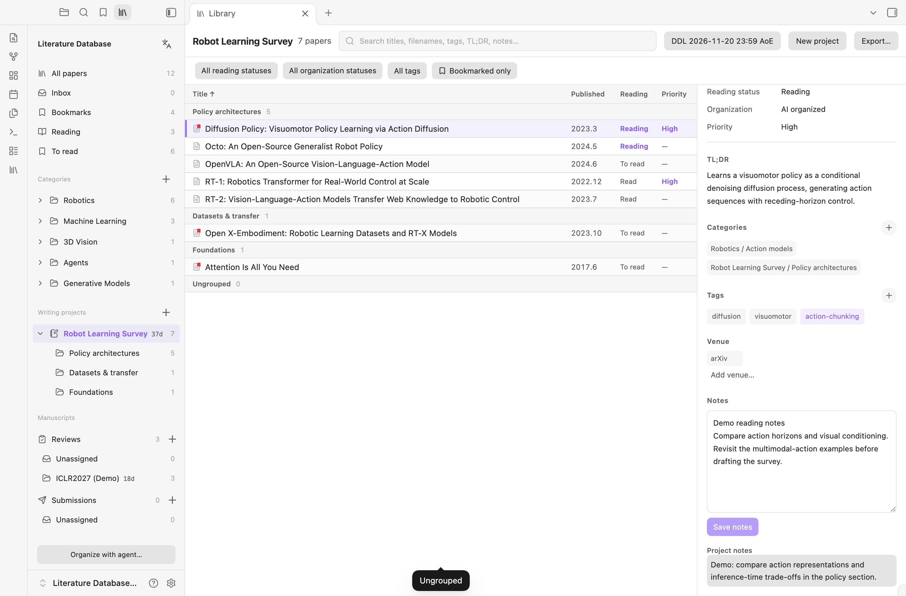
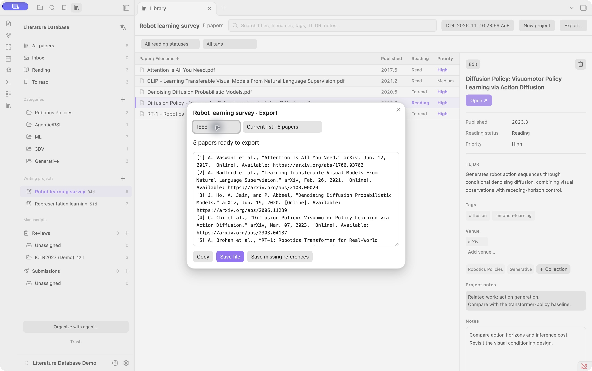
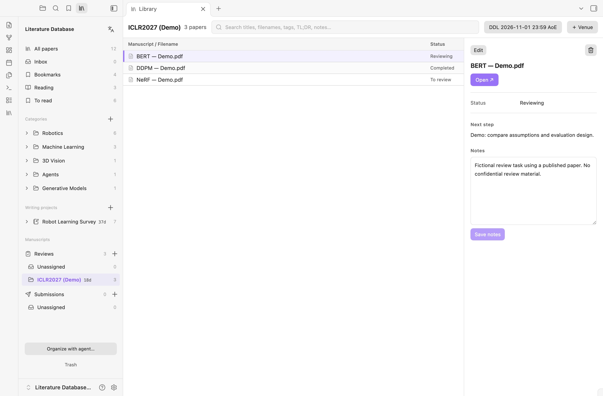

# Literature Database

A compact, Zotero-style literature manager for Obsidian, by **shengzhegan**. Browse collections on the left, papers in a dense list, and metadata and notes on the right. Your library stays in Markdown, with PDFs stored as ordinary files.

[中文使用指南](docs/usage.zh-CN.md) · [Installation](#try-the-current-version) · [Development](docs/development.md) · [Community release preparation](docs/community-release.md)

*Real screenshots from a separate demo vault, using the English interface. Public papers are paired with example notes, projects and review tasks; no private library or confidential manuscripts are shown. Click any image to view it at full size.*

**Status:** **4.8.3**. [View the Community listing](https://community.obsidian.md/plugins/paper-reservoir-dashboard); new releases may take time to reach the in-app directory. Requires **Obsidian 1.8.7+**. Mobile support is enabled for iPhone/iPad with a compact touch layout and Files picker. Validated with Obsidian 1.14.4 mobile emulation and a runtime test that rejects Node/Electron imports; physical iOS/Android devices have not yet been tested. Desktop behavior is preserved. Windows/Linux GUI behavior has not been validated; Finder drag/paste requires macOS. The interface supports English and Chinese, following the Obsidian language by default. Screenshots show the 4.8.0 interface in an isolated English demo vault.

## Features

**New in 4.8.3:** Drag the divider to resize the paper list and details with a mouse or touch. Hover or press to highlight it; sizes are remembered in the workspace, with minimum sizes for both panes. Mobile sidebar names save on Done or an outside tap, and tag creation has a visible cancel button.

**4.8.0:** Build and select tags in an editable, two-sided mind map. Combine several tag filters with **OR** semantics, bookmark papers from the right-click menu, and use larger mobile disclosure targets. Mobile icon buttons retain their intended shape; iPad details now expand smoothly as well as phone details.

**4.7.0:** Create one level of subcategories inside categories and writing projects. Each paper appears once per parent, independently of its tags. Drag papers or PDFs into a child section, scroll the middle list while dragging, and see newly imported papers selected and brought into view. Sidebar expansion animates gently; empty **Ungrouped** entries stay hidden.

**4.6.1:** Filter bookmarked papers within the current category or writing project with **Bookmarked only**. Combine it with search, reading status, organization status and tags. Filter controls fit their selected labels and keep a consistent height.

**Bookmarks (4.6.0):** Bookmark papers from the details pane. **Bookmarks**, between Inbox and Reading, groups them by research category; papers in multiple categories appear in each, while counts, exports and batch actions stay deduplicated. A small red bookmark overlaps the PDF icon. Bookmarks survive trash/restore and remain under user control during agent organization. Short chip and control animations respect reduced motion, and bookmark saves update in place without flashing unrelated controls or disturbing Notes.

**4.5.2 mobile:** Browse, edit Notes/status, manage collections, open PDFs and export references on mobile. Use **＋** to import PDFs from Files into the inbox or a selected collection, project or manuscript venue. Original names are preserved; explicitly selected companion files stay paired. Phone lists and details use a flat layout separated by a 3px line; filters collapse by default and details expand smoothly without discarding drafts. Phones reserve only the system-reported status-bar safe area, without the hidden header’s extra gap. iPad top spacing is unchanged. Tablets use two columns when space permits.

**4.4.1:** Reliable publication dates now fill automatically as `YYYY.M`. Successful metadata extraction selects **Auto organized** in the existing organization selector; these papers remain eligible for agent summaries/tags. Human and AI completion states are preserved. arXiv first-submission dates are used instead of revision or PDF creation dates.

**New in 4.4.0:** Drop PDFs directly into a category or writing project on macOS. A record appears immediately with its original filename as a provisional title, empty tags/TL;DR and a pending organization status. Edit the title yourself or hand off pending/incomplete entries to an agent. Human tags use the accent color; AI tags are neutral, with source tooltips. Choose **Manually complete** to exclude an entry from future agent enrichment. Existing content has unrecorded provenance unless its source was explicitly tracked. See [the maintenance contract](templates/empty-vault/AGENTS.md).

### A compact workspace for reading

- **One row per paper.** Browse categories on the left, scan paper titles in the middle, and read the confirmed title, TL;DR, tags, venues and notes on the right.
- **Adjust your workspace.** Drag the list/detail divider sideways in columns or vertically in a stacked layout. The divider also supports arrow keys, Shift for larger steps, and Home/End. Expanding and collapsing details preserves your chosen size and unsaved Notes.
- **Edit in place.** Change reading status, organization status and priority directly in the details pane. Save notes while staying on the same paper.
- **Find papers quickly.** Search titles, filenames, tags, TL;DR and notes; filter by reading status, organization status or several tags, and sort the list. Selected tags match **any** chosen tag, without duplicating papers.
- **Keep your PDF reader.** **Open ↗** uses the system's default application. Skim is optional; the plugin does not embed a second desktop PDF viewer.

### Build your tag vocabulary visually

Click the circular **+** beside **Tags** in the details pane. Each branch has its own **+**: type a group, tag or child tag in place, then press Enter or tap the checkmark. On mobile, tap the cancel button beside the input to discard an unfinished branch without closing the map. Creating a tag adds it to the vocabulary; check its box to assign it to the selected paper. Parent and child tags are independent, and the common `research/` prefix stays hidden in the interface.

Pan, zoom, search or fold branches to navigate a growing vocabulary. Groups spread to both sides of the root and keep their side while the map is open. Human-added tags retain the accent color, while AI/unknown tags remain neutral. Assignments preserve the selected paper and unsaved Notes. The optional `tags.md` stores only vocabulary and visual groups; each paper's tags remain in `library.md`.

Use **All tags** above the list to select multiple tags, with search and clear controls. The filter matches any selected exact tag (OR); choosing a parent does not implicitly include its children. Right-click one or several public papers to add or remove bookmarks.

### Gather references for each writing project

A paper can belong to several categories and writing projects while keeping one PDF and one metadata record. Drag papers into a collection to add them, or use the native checked menu to manage memberships. Explicitly move or remove a membership when needed.

Removing a paper's last membership offers **Cancel** or **Move papers to trash everywhere**. If a paper belongs to multiple collections, a trash action lets you choose between removing only the current membership and moving the paper to trash everywhere. Restoration brings back its memberships and project notes. The same safeguards cover native checkboxes, keyboard removal and batch selections; explicit moves can still replace a membership. Smart views such as All papers have no current collection to remove from.

Right-click a category or writing project to create a subcategory; rename it inline or drag to reorder it. Select the parent to browse grouped sections, or a child to see only its papers. Moving between children of the same parent changes placement; dropping into another parent adds a membership. Removing a child returns its papers to **Ungrouped**, without deleting them. Subcategories inherit their project deadline and retain project notes. Existing papers are not automatically classified, and new libraries still start empty.

Project notes capture why a paper matters to a particular draft, independently of its shared personal notes. Projects have their own deadlines and sidebar countdowns, including **AoE**. They remain separate from submissions; deadline sharing happens only when you explicitly choose it.

### Export references when you write

Export the current list or selected papers, preview the result, then copy it or save a file.

| Format | Output |
| --- | --- |
| **BibTeX** | `.bib`, preserving stored entries and citation keys |
| **APA 7** | Formatted HTML, with plain-text or rich-text copying |
| **IEEE** | Numbered references in HTML, with plain-text or rich-text copying |
| **Title list** | `.txt`, one confirmed paper title per line—not filenames |

Citation recognition uses PDF evidence and verified Crossref/arXiv lookups. Formatting is deterministic; agents do not invent bibliographies. Missing or uncertain records are reported instead of filled with guesses. Recognition runs on demand, without a background full-library scan.

### Track reviews and submissions by venue

Keep review tasks and your own submissions in separate trackers. Drop PDFs into a venue or its unassigned area, drag tasks between venues, and change review status directly in the right pane: **To review → Reviewing → Completed**. Each venue has one deadline, a time-zone selector and a countdown. Deleting a venue returns its papers to the unassigned area.

*The ICLR2027 (Demo) tasks above use already published BERT, NeRF and DDPM papers. The assignments, notes and deadline are fictional examples, not actual ICLR submissions, reviews or official dates.*

### Built around ordinary files

- **PDF inbox:** drag from Finder or right-click the empty inbox area and choose **Paste** on macOS. Original files and matching annotation sidecars are preserved.
- **Recoverable trash:** multi-select, batch restore and batch permanent deletion with one confirmation. File collisions are never overwritten.
- **English and Chinese:** switch from the sidebar or follow Obsidian's language; your paper titles and notes are not translated.
- **Manual agent handoff:** copy organization instructions when you want help. No scheduled agent runs, per-paper Markdown files or second JSON metadata database.
- **Portable storage:** metadata and memberships live in Markdown; PDFs and Skim sidecars remain ordinary vault files. File syncing is handled by your vault's storage provider.

## Try the current version

Use a separate vault for the literature library. Open the [Community listing](https://community.obsidian.md/plugins/paper-reservoir-dashboard) and choose **Add to Obsidian**, or search for **Literature Database** in Community plugins. For manual installation while directory updates propagate:

1. Download `main.js`, `manifest.json` and `styles.css` from the [latest release](https://github.com/Lgx521/Literature_Database_Obsidian/releases/latest).
2. Create `<vault>/.obsidian/plugins/paper-reservoir-dashboard/` and place the three files there. Use your vault's configured configuration folder if it differs from `.obsidian`.
3. Reload Obsidian and enable **Literature Database** in Community plugins.
4. Click the library ribbon icon, or run **Literature Database: Open library** from the command palette. In a fresh vault, choose **Create library**. This creates four empty source tables, the attachment folders and an `AGENTS.md` if one does not already exist. It never replaces existing source files.
5. Drag PDFs into Inbox, or copy PDFs in Finder and paste into the empty inbox area on macOS. Use **Organize with agent…** to copy instructions for a manually triggered agent with local file access; then review its changes. Dropping a PDF into Inbox alone does not add it to the public library.

New libraries start with **no categories or writing projects**. Create your own with the sidebar **+** buttons; the categories in the screenshots are demo examples, not defaults.

New installations keep **Open library on startup** and **Open source tables in library** off. You can enable either under **Settings → Literature Database**. Existing libraries retain their previous startup behavior unless you turn it off. The source tables use a fixed schema; [empty templates](templates/empty-vault) remain available for inspection or manual setup. If setup is interrupted, preserve any files already created and check them before completing the missing templates; never overwrite a partially synced library.

To build from source instead, install Node.js 20+ and Python 3, clone this repository and run `npm run build`. Normal builds need no dependency installation. Use the resulting three runtime files in step 2.

The internal plugin ID remains `paper-reservoir-dashboard` for compatibility with existing installations.

## Interface language and existing vaults

Use the language icon beside **Literature Database** in the sidebar, or run **Change interface language…** from the command palette. Choose **Follow Obsidian**, **中文** or **English**. The preference syncs with the plugin settings. Save or cancel any edits before switching; paper titles, notes, tags, venue names and stored schema values are never translated.

On upgrade, the plugin backs up and renames the four legacy Chinese source filenames to the English names below. It preserves their contents and historical trash receipts. If both versions of a filename exist, migration stops without overwriting either file; resolve the conflict before reloading. Do not create a second set of source files by copying the empty templates into an existing vault.

## Data and privacy

The canonical files are `library.md` (paper metadata), `collections.md` (collection/project memberships), `reviews.md` (reviews) and `submissions.md` (submissions). Both the middle list and right-hand heading use the paper title. The actual PDF filename appears in smaller text in the details pane. Imported filenames are never normalized or renamed; same-name files use separate subfolders. Existing files are not renamed back. Until a real title is known, the original filename is a provisional title, excluded from title exports. Skim `.skim`, `.fdf` and `.xfdf` sidecars stay paired with their PDFs.

The plugin makes local backups before edits, checks for concurrent changes and keeps recoverable deletions under `.maintenance-backups/deleted/`. Permanent deletion removes only the selected archived record and its attachments. This is not a substitute for a separate backup. iCloud and other file sync are provided by your vault's storage provider; this plugin does not implement a sync service.

**Network access:** citation recognition uses `api.crossref.org`, `export.arxiv.org` and, when needed, `arxiv.org`. Requests contain a public identifier or paper title. It does not upload PDFs, personal notes, review manuscripts or submission attachments. Recognition runs for newly admitted public papers while the plugin is active, for exports missing citations, or after the explicit retry command; it does not scan the entire library on startup. Uncertain matches remain empty. Existing bibliography fields are preserved.

**Mobile import:** The Files picker reads only the files you select through browser File objects, then writes through the Obsidian vault API. It cannot discover neighboring annotation files or copy macOS extended attributes; select matching `.skim`/`.fdf`/`.xfdf` companions together, or sync them via iCloud. Mobile **Open ↗** uses Obsidian's PDF viewer.

**Outside-vault access:** when you explicitly drop or paste local PDFs on macOS, the importer reads those files and matching annotation sidecars and copies them into the vault using `ditto`, preserving extended attributes. It reads the clipboard only when Paste is chosen. Opening a PDF invokes the default desktop application (`/usr/bin/open` on macOS). The plugin does not change your default PDF application.

No account, payment or analytics is required by the plugin. The optional agent button copies instructions; it does not itself launch an AI model or send your library to one.

## License and attribution

Copyright (c) 2026 shengzhegan. Project code is licensed under **GNU AGPL-3.0-only**; see [LICENSE](LICENSE).

Citation formatting includes Citation.js (MIT), citeproc-js by Frank Bennett (using its AGPL v3-or-later option), and CSL APA/IEEE styles (CC BY-SA 3.0). Other bundled dependencies retain their own licenses. Full notices, versions and rebuild instructions are in [THIRD-PARTY.md](scripts/vendor/THIRD-PARTY.md). The project license does not replace those licenses.

This project is not affiliated with Obsidian, Zotero or Skim.
